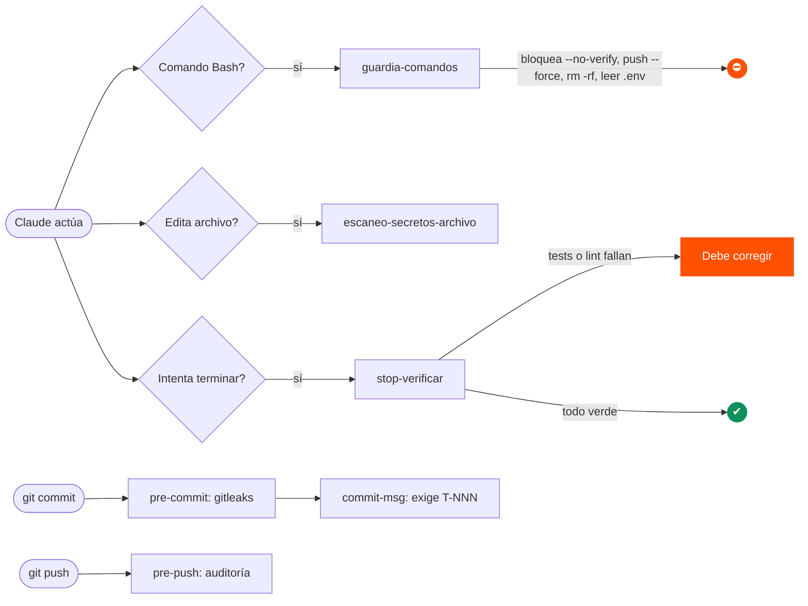

<div align="center">


<br>


**Plantilla base que se copia a cada proyecto para que Claude trabaje con plan, memoria, tests y seguridad.**

[Qué es](#-qué-es) · [Instalación](#-instalación-en-5-minutos) · [Flujo](#-flujo-de-trabajo) · [Automatismos](#-qué-se-ejecuta-solo) · [Estructura](#-estructura) · [Adaptar](#-cómo-adaptarlo) · [FAQ](#-problemas-frecuentes)

</div>

---

## 🎯 Qué es

Un conjunto de archivos que se copia a la raíz de cualquier proyecto. La idea central: **las reglas se cumplen por mecanismo (hooks), no porque Claude se acuerde.**

| | Capacidad | Cómo se garantiza |
|---|---|---|
| 🗂️ | **Plan** con tareas `T-001`, prioridad y estado | Skill `planificacion` + `TAREAS.md` |
| 🧠 | **Memoria** de decisiones entre sesiones | Skill `memoria` + `MEMORIA.md` |
| ✅ | **Tests atómicos** junto a cada pieza | Skill `tests-atomicos` + hook `Stop` |
| 🔒 | **Seguridad** por defecto | Hooks, gitleaks y auditoría en `pre-push` |
| 🎨 | **Identidad visual** Diusframi | `brand/` + skill `diseno-diusframi` |
| 🏁 | **Definición única de "Hecho"** | Checklist en `CLAUDE.md` |

## 🚀 Instalación en 5 minutos

> **Requisitos:** Windows con PowerShell 5.1+, Git y, según el stack, Go, Rust o Node.

**1. Crea el proyecto con una sola línea:**

```bat
git clone --depth 1 https://github.com/pimgux/arnes-diusframi arnes-tmp && powershell -NoProfile -ExecutionPolicy Bypass -File arnes-tmp/scripts/nuevo-proyecto.ps1
```

> Vale para **cmd**, Git Bash y PowerShell 7. En Windows PowerShell 5.1 (el azul de Windows) `&&` no existe: sustitúyelo por `;`.

El script te pregunta el **nombre** y el **objetivo** del proyecto y con ellos:

- crea la carpeta con el nombre del proyecto (los espacios pasan a `-`),
- rellena **Nombre** y **Objetivo** en `CLAUDE.md`,
- **elimina el historial** de la plantilla e inicia un repositorio limpio (`main`),
- activa los hooks de git y te dice qué herramientas faltan (gitleaks, govulncheck, cargo-audit),
- borra la carpeta temporal `arnes-tmp`.

**2. Completa** el **Stack elegido** en `CLAUDE.md` y copia `.env.example` a `.env`.

**3. Abre Claude Code** en la carpeta del proyecto. Los hooks de `.claude/settings.json` se cargan solos (la primera vez pedirá confirmación).

## 🔄 Flujo de trabajo



1. Pide a Claude: *"Planifica con la skill planificacion"*.
2. Revisa `TAREAS.md` y aprueba.
3. Claude ejecuta tarea a tarea: **código + test → verificar → memoria → commit `T-00X: …`**.
4. Al cerrar, comprueba que `MEMORIA.md` y `README.md` reflejan el trabajo.

Una tarea solo pasa a `Hecha` si cumple la [checklist de `CLAUDE.md`](CLAUDE.md#definición-de-hecho-checklist-única).

## ⚙️ Qué se ejecuta solo



| Cuándo | Qué | Efecto |
|---|---|---|
| Antes de un comando Bash | `guardia-comandos.ps1` | Bloquea `--no-verify`, `push --force`, `rm -rf`, leer `.env`… |
| Tras editar un archivo | `escaneo-secretos-archivo.ps1` | Avisa de posibles secretos |
| Al intentar terminar | `stop-verificar.ps1` → `verificar.ps1` | Corre tests + lint; si fallan, Claude **no puede terminar** (máx. 3 intentos para no entrar en bucle) |
| `git commit` | `pre-commit`, `commit-msg` | Bloquea secretos y commits sin ID de tarea |
| `git push` | `pre-push` (`auditoria.ps1`) | govulncheck, cargo audit, npm audit, gitleaks |

`verificar.ps1` detecta el stack por archivos (`go.mod`, `Cargo.toml`, `package.json`, hasta un nivel de subcarpeta). Sin tests detectados, pasa.

## 🧱 Stack por defecto

| Necesidad | Usar |
|---|---|
| Web | HTML + CSS + JS (sin framework salvo necesidad justificada) |
| Datos pequeños / locales | SQLite |
| Datos grandes / multiusuario | MySQL |
| Aplicación de escritorio | Rust |
| API / backend | Go |

Si el requisito no encaja, se propone la alternativa y se registra en `MEMORIA.md`.

## 📁 Estructura

```
.
├── CLAUDE.md          reglas del proyecto, infraestructura y checklist de "Hecho"
├── TAREAS.md          plan: ID, prioridad (P1–P3) y estado
├── MEMORIA.md         decisiones y aprendizajes entre sesiones
├── .claude/
│   ├── settings.json  permisos y registro de hooks
│   ├── hooks/         guardia de comandos, escaneo de secretos, verificación al terminar
│   └── skills/        planificacion · tests-atomicos · seguridad · memoria · diseno-diusframi
├── .githooks/         pre-commit · commit-msg · pre-push
├── scripts/           verificar · auditoria · nuevo-proyecto · instalar-hooks-git
├── brand/             tokens, componentes, Tailwind/shadcn y logos Diusframi
└── docs/              guía del arnés, seguridad e identidad visual
```

## 🛠️ Comandos

| Acción | Comando |
|---|---|
| Verificar todo (tests + lint) | `powershell -NoProfile -ExecutionPolicy Bypass -File scripts/verificar.ps1` |
| Auditoría de seguridad | `powershell -NoProfile -ExecutionPolicy Bypass -File scripts/auditoria.ps1` |
| Reactivar hooks de git en un clon existente | `powershell -NoProfile -ExecutionPolicy Bypass -File scripts/instalar-hooks-git.ps1` |

## 🧩 Cómo adaptarlo

- **Otro stack:** añade un bloque en `verificar.ps1` y `auditoria.ps1` siguiendo el patrón existente y actualiza la tabla de `CLAUDE.md`.
- **Permisos:** edita `permissions` en `.claude/settings.json`. Las preferencias personales van en `.claude/settings.local.json` (ignorado por git).
- **Reglas del guardia:** añade una entrada `Patron`/`Motivo` en `guardia-comandos.ps1`.
- **Checklist de "Hecho":** edítala solo en `CLAUDE.md`; es la única copia.
- **Marca:** reemplaza `brand/` y `docs/diseno/IDENTIDAD.md` con la versión nueva del pack de identidad.

## 🎨 Identidad visual

Toda interfaz importa `brand/tokens.css` y usa variables `var(--ds-*)`. Tipografía **Inter**, solo paleta corporativa y logo sin alterar.

<p>
  
  
  
  
</p>

Detalle en [`docs/diseno/IDENTIDAD.md`](docs/diseno/IDENTIDAD.md).

## 🔒 Seguridad

- Nunca secretos en código, logs ni commits: variables de entorno y `.env.example`.
- Entradas externas validadas; consultas SQL siempre parametrizadas.
- Mínimo privilegio y dependencias mínimas.
- **Nunca** `--no-verify`.

Más en [`docs/SEGURIDAD.md`](docs/SEGURIDAD.md).

## ❓ Problemas frecuentes

<details>
<summary><b>El hook no se ejecuta</b></summary>

Revisa que `powershell` esté en el PATH y que aceptaste los hooks al abrir Claude Code. Compruébalo con `/hooks`.
</details>

<details>
<summary><b>"gitleaks no está instalado" al commitear</b></summary>

```powershell
winget install gitleaks.gitleaks
```
</details>

<details>
<summary><b>Claude no termina y los tests fallan</b></summary>

Es lo esperado: corrige el fallo. Tras 3 intentos se libera con aviso.
</details>

<details>
<summary><b>Commit rechazado</b></summary>

Falta el ID de tarea en el mensaje. Formato: `T-003: descripción corta`.
</details>

<details>
<summary><b>Falso positivo de secreto</b></summary>

Ajusta la allowlist de `.gitleaks.toml` o el patrón del hook. Nunca uses `--no-verify`.
</details>

<details>
<summary><b>`$CLAUDE_PROJECT_DIR` no se resuelve en los hooks</b></summary>

Si tu shell de hooks no es Git Bash, cambia por ruta relativa `.claude/hooks/...`.
</details>

## 🗺️ Pendiente

- [ ] CI que repita `verificar.ps1` y `auditoria.ps1 -Estricto` (los hooks locales se pueden saltar a mano).

---

<div align="center">

Guía completa: [`docs/GUIA-ARNES.md`](docs/GUIA-ARNES.md) · Estado del trabajo: [`TAREAS.md`](TAREAS.md)

<sub>Hecho en Diusframi</sub>

</div>
